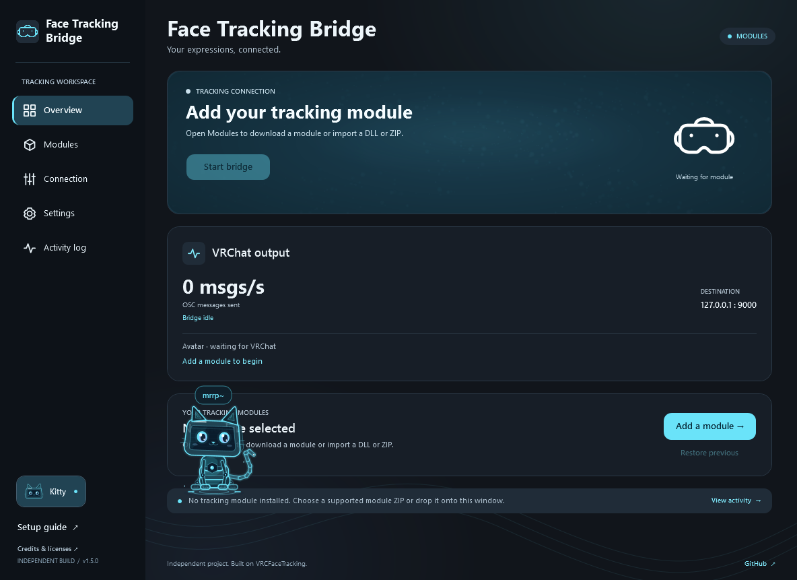

# Face Tracking Bridge

<h2 align="center">
  <a href="https://github.com/ClassicWasTaken/FaceTrackingBridge/releases/latest/download/FaceTracking-Bridge-Setup.exe">⬇ Download for Windows (.exe)</a>
</h2>

  <a href="https://babble.diy/">Visit the Project Babble website ↗</a>

A Windows app that bridges eye and face tracking to VRChat through compatible **VRCFaceTracking SDK** modules. Download modules for Babble Headset Runtime, Baballonia, Virtual Desktop, Steam Link, SRanipal, Bigscreen Beyond, or EyeTrackVR. Works with Jerry’s templates and VRChat’s native face-tracking SDK beta; available tracking depends on your hardware and module.

Local preview 5 (**1.5.0**) adds separate eye and face sources. This preview has not been published.

## Get started

1. Install the app and download a **VRCFaceTracking module** from Modules, or import a module DLL or ZIP.
2. In Modules, choose **Eyes & eyebrows** and **Face & mouth**, then click **Apply sources**. Start each source’s **headset runtime or desktop tracking app**.
3. Enable **OSC** in VRChat and select a face-tracking avatar.

Use the same module for both, or combine eyes from one module with the face from another. A shared module runs once; separate modules are isolated and feed one combined VRChat output. **Use module** assigns that module to both roles. Your source pair and each module’s settings are remembered.

Downloads come from the module authors; modules are never bundled. The bridge can only send expressions your sources measure. Known overlapping input ports are rejected; give the modules and their tracking apps different input ports before combining them. Remove modules with the trash button. Removing either selected source stops the bridge and clears both roles; your other modules stay installed.

Using Baballonia Expressions Alpha? Download **Baballonia** in Modules, or choose **Update for Expressions Alpha** on an older imported module.

In **Settings**, choose whether to start with SteamVR, close when it exits, or **start minimized to system tray**. Clicking **X** keeps tracking running in the tray; double-click the tray icon to reopen, or right-click it to **Quit**.

Click the **kitty face in the bottom-left corner** to meet Relay, an optional holographic robot cat. Relay starts **off every time you open the app**. Pick it up and drag it around, or let it climb onto visible panels and sit on their edges. Its small, local recurrent model guides play, grooming, investigation and rest; a separate controller handles climbing and pickup. Relay is completely silent: cat sounds appear only as little text bubbles. The companion pauses in the tray. [Behavior and research notes](docs/RELAY-BEHAVIOR.md).

The tracking-connection particles smoothly coast to a stop and dim when the bridge stops, then brighten and resume when it starts.

Other compatible VRCFaceTracking SDK modules work too. `module.json` is optional; use a ZIP if a module needs supporting files.

Only import modules from publishers you trust: they run code on your PC under their own licenses.

Windows 10/11 x64. [Setup & requirements](START-HERE.txt) · [Build from source](BUILD.txt)

Original code: [Apache 2.0](LICENSE). [Copyrights & third-party licenses](THIRD_PARTY_NOTICES.md).

[Pull requests welcome](CONTRIBUTING.md) · [Report a security issue privately](SECURITY.md)

Independent project; not endorsed by Project Babble, VRCFaceTracking, Valve, or VRChat.
