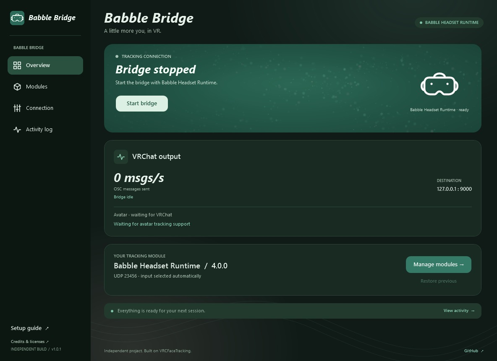

# Babble Bridge

<h2 align="center">
  <a href="https://github.com/ClassicWasTaken/BabbleBridge/releases/latest/download/Babble-Bridge-Setup.exe">⬇ Download for Windows (.exe)</a>
</h2>

  <a href="https://babble.diy/">Visit the Project Babble website ↗</a>

A Windows app that bridges eye and face tracking to VRChat through compatible **VRCFaceTracking SDK** modules. Supports Babble Headset Runtime, Baballonia desktop, Virtual Desktop, and Steam Link, with Jerry’s templates and VRChat’s native face-tracking SDK beta.

## Get started

1. Install the app and download a **VRCFaceTracking module** from Modules, or import a module DLL or ZIP.
2. Select your module and start its **headset runtime or desktop tracking app**.
3. Enable **OSC** in VRChat and select a face-tracking avatar.

Downloads come from the module authors; modules are never bundled. Your selected module is remembered, with its own connection settings. Remove imported modules with the trash button. Jerry’s templates are supported.

Other compatible VRCFaceTracking SDK modules work too. `module.json` is optional; use a ZIP if a module needs supporting files.

Only import modules from publishers you trust: they run code on your PC under their own licenses.

Windows 10/11 x64. [Setup & requirements](START-HERE.txt) · [Build from source](BUILD.txt)

Original code: [Apache 2.0](LICENSE). [Copyrights & third-party licenses](THIRD_PARTY_NOTICES.md).

[Pull requests welcome](CONTRIBUTING.md) · [Report a security issue privately](SECURITY.md)

Independent project; not endorsed by Project Babble, VRCFaceTracking, Valve, or VRChat.
